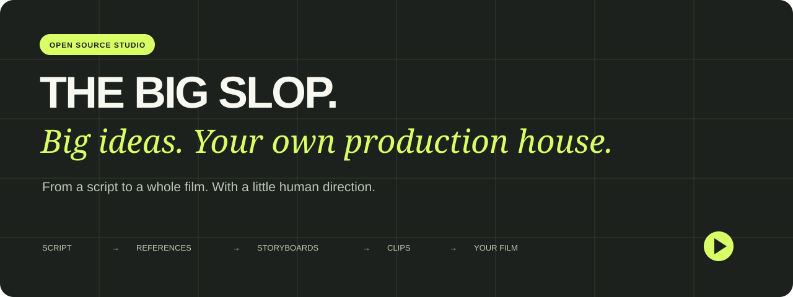

<p align="center"></p>

<p align="center">
  <a href="LICENSE"></a>
  <a href="https://github.com/leviseyes/the-big-slop/actions/workflows/ci.yml"></a>
  
</p>

# Your script. A whole movie. Your own studio.

**The Big Slop is an open-source, self-hosted filmmaking studio.** Start with a screenplay or an idea. An AI director plans the production, builds the cast and world, draws shot-by-shot storyboards, generates video clips, and stitches them into a film. You review the creative decisions along the way.

**Our goal is a “slopless” feature film from just a script. Getting there takes time, money, experimentation, and better models.** Today, expect visual mistakes, imperfect continuity, and occasional spectacular nonsense. Start with a short 480p concept film: see the story, explore its potential, and test pacing before committing to a bigger production.

[Quick start](#quick-start) · [API key guide](docs/api-keys.md) · [Self-hosting](docs/self-hosting.md) · [Workflow](docs/workflow.md) · [Roadmap](ROADMAP.md) · [Contribute](CONTRIBUTING.md)

## What you can do

- Write, paste or import TXT, PDF, DOCX, Fountain and Final Draft scripts; develop an idea into a script.
- Choose a format, target runtime, dialogue languages, rendered-text languages, and 480p or 720p video.
- Generate character, location and object references; review them, upload replacements, edit multiple references and descriptions, and download the collection.
- Review sequential storyboard panels with consistent framing. Accept shots individually or together, then explicitly continue.
- Bind Seedance prompts to the actual ordered reference images, timed action, dialogue and continuity instructions.
- Carry the previous clip’s final frame into a continuous shot, with explicit cuts for scene changes.
- Organize productions and recurring series, reuse their references, and browse a private viewing library.
- Resume saved jobs and provider requests after interruptions. Unknown submission outcomes pause for review instead of silently charging you twice.

## What “self-hosted” means here

The web studio, database, media storage and render worker run under your control. The local edition uses Cloudflare’s local D1/R2 emulator; an optional deployment uses **your** Cloudflare account. AI generation still sends relevant scripts, prompts and media to **OpenAI and Higgsfield** using your server-side API keys. These proprietary models are not included or open source. There is no offline generation mode.

This first release is a **single-owner studio**, not a public multi-tenant SaaS. It has an independent password sign-in. Payments are disabled; there is no platform wallet or 20% markup in this release. Model usage and hosting can cost money even though the software is free. Check model access and current prices before starting.

## Quick start

Install [Node.js 24 LTS](https://nodejs.org/) and [FFmpeg](https://ffmpeg.org/download.html). FFmpeg and ffprobe must be on PATH for video work. A comfortable starting point is 4 CPU cores, 8 GB RAM and ample free disk space; long films need much more media storage. This is a starting recommendation, not a measured capacity guarantee.

```sh
git clone https://github.com/leviseyes/the-big-slop.git
cd the-big-slop
npm ci
npm run setup
npm run db:migrate
npm run build
npm start
```

Open **http://127.0.0.1:5173**. Setup saves a randomly generated sign-in password in `.studio-password`, readable only by your OS account. Use it to sign in. You can explore the UI and save scripts without API keys.

To enable generation:

1. Follow the [API key guide](docs/api-keys.md). Add your own keys to `.env` and `.dev.vars`; keep the generated authentication fields intact.
2. Restart the studio, then run `npm run worker` in a second terminal.
3. Try the sample script with a short runtime. Planning and images incur provider charges when you approve those stages. Video generation requires a separate estimate acceptance.

**Never share `.env`, `.dev.vars`, `.studio-password`, `worker-state`, or your database.** See [security and backups](docs/self-hosting.md).

### Docker

After `npm run setup` (Node is needed for this one-time setup), add your keys as above:

```sh
docker compose build
docker compose run --rm migrate
docker compose up -d studio
# Start only when ready to process approved generation jobs:
docker compose --profile generation up -d worker
```

The web port binds to localhost. Named volumes preserve the database, media and worker checkpoints. `docker compose down` preserves them; **do not add `-v`** unless you intend to erase your studio. See [deployment and upgrades](docs/self-hosting.md) before exposing a server.

## The production flow

```mermaid
flowchart LR
  A[Script or idea] --> B[Director plan]
  B --> C[Approve runtime]
  C --> D[Generate references]
  D --> E[Review and edit references]
  E --> F[Build storyboards]
  F --> G[Review all shots]
  G --> H[Frames and estimate]
  H --> I[Approve cost]
  I --> J[Generate clips]
  J --> K[FFmpeg assembly]
  K --> L[Watch and download]
```



## Models and limits

| Job | Integration in this release |
| --- | --- |
| Director | OpenAI `gpt-6-astra` (default) or `gpt-5.6-sol`, medium reasoning |
| Reference images and storyboard sources | OpenAI `gpt-image-2.5-sunburst`, 1024×1024 only |
| Video | Higgsfield `bytedance/seedance-2.5/reference-to-video`; legacy image-to-video support |
| Duration | Planned in 30-second sequences; runtime rounded to the supported sequence count |
| Resolution | 480p and 720p exposed; 1080p is not enabled in this release |
| Assembly | Local FFmpeg/ffprobe |

**Access is account-specific.** Verify these exact model IDs in your provider account. Do not assume a ChatGPT subscription grants API access or API credits. If a required model is unavailable, generation cannot run on that account; the app does not secretly substitute a different model. The resolution list describes this release, not every capability of the provider.

## Demo and examples

The studio includes **The Last Customer**, an original sample script, available through “Try a sample script.” The source is also in [examples/the-last-customer.fountain](examples/the-last-customer.fountain). [Demo walkthrough](docs/demo.md) explains the review gates and where charges begin.

The test suite renders synthetic video fixtures through real FFmpeg. Those fixtures verify assembly and recovery; they are not examples of model output quality.

## Development

```sh
npm run dev
npm test
npm run typecheck
npm run test:workers
# With an initialized local studio running:
npm run test:api
```

Provider calls in unit and worker smoke tests are intercepted; those tests do not spend API credits. `test:api` uses your local sign-in and checks authorization. Additional integration smoke tests modify a disposable local database; read [CONTRIBUTING.md](CONTRIBUTING.md) before running them.

## Help build the studio

If the project is useful, **star it** so you can find it again, try a short production, and share a reproducible issue. Contributions to continuity, installation, accessibility, cost visibility and provider adapters are welcome. Please share only scripts and media you have permission to publish, and redact credentials and private production data.

See [known limitations](docs/limitations.md), [roadmap](ROADMAP.md), [security policy](SECURITY.md), and [contribution guide](CONTRIBUTING.md).

## License

The Big Slop source is licensed under [Apache 2.0](LICENSE). Bundled third-party notices are in [THIRD_PARTY_NOTICES.md](THIRD_PARTY_NOTICES.md). The code license does not grant access to AI models, provider services, trademarks or third-party media. Provider terms and content policies still apply, including to commercial deployments. This is an independent project, not an official OpenAI, Higgsfield or ByteDance product.
